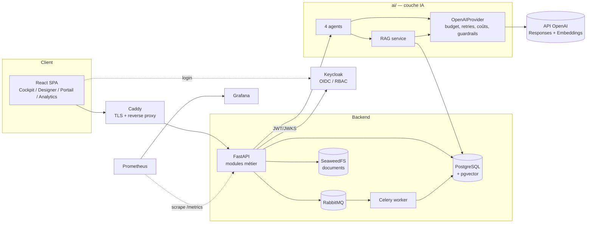
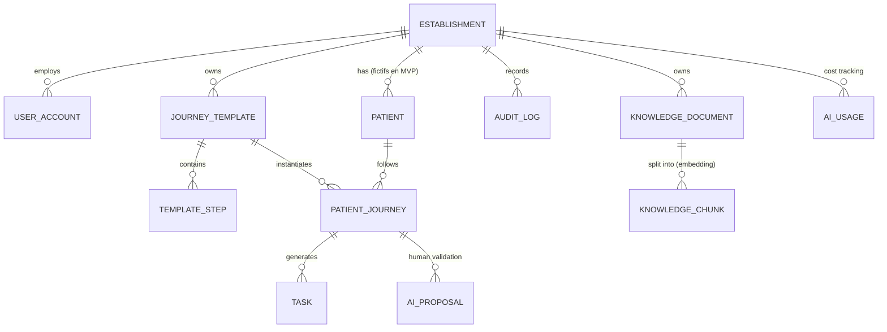

# CarePilot — Architecture (Phase 1)

> Statut : MVP technique. Cette architecture **n'est pas** présentée comme conforme RGPD / HDS.
> Voir `docs/security.md` pour les prérequis juridiques avant tout traitement de données réelles.

## 1. Vue d'ensemble

Monolithe modulaire : une API FastAPI, un worker Celery, une SPA React, et une couche IA
(`ai/`) indépendante du métier (aucun import de `app.*` depuis `ai/`).

## 2. Modèle de données

Règle : **toute table métier porte `establishment_id`**, et toute requête est filtrée
par l'établissement du jeton (cf. `app/tenancy.py`).

## 3. Backend

`apps/api/app/` : `config`, `db`, `models`, `security` (OIDC + RBAC), `tenancy`,
`services/` (journeys, cockpit, analytics, audit), `routers/` (REST/OpenAPI),
`rag_store` (adaptateur SQLAlchemy du `VectorStore` de `ai/rag`).
Migrations Alembic ; `pgvector` activé par la migration initiale.

## 4. Frontend

React + TS + Vite, TanStack Query. Pages : Cockpit (livré), Designer (React Flow),
Portail patient, Analytics (Recharts) — voir `README.md` pour l'état d'avancement.

## 5. IA et RAG

- `ai/providers/openai_provider.py` : seul point d'appel OpenAI (Responses + Embeddings).
  Retries/timeout via le SDK, budget mensuel par établissement, coût estimé (tarifs configurables),
  sortie structurée validée par Pydantic, logs = métadonnées uniquement.
- `MockProvider` : tests sans réseau.
- Guardrails : interrupteur IA (global + par établissement), détection/redaction d'identifiants
  directs (e-mail, téléphone, NIR), filtre de contenu médical sur les messages.
- Agents (outils limités, sorties typées) → produisent des **propositions** (`AI_PROPOSAL`) que
  le coordinateur valide ; aucun agent ne modifie un statut directement.
- RAG : documents de procédure approuvés uniquement → chunks → embeddings → pgvector →
  recherche filtrée par établissement ET `status='approved'`. Aucun embedding de donnée patient.

## 6. Modèle de sécurité (résumé)

| Menace | Mesure |
|---|---|
| Accès inter-établissements | `establishment_id` du jeton, filtre systématique, tests dédiés |
| Escalade de rôle | RBAC Keycloak (`admin`, `coordinator`, `designer`, `viewer`) |
| Fuite vers OpenAI | redaction + pseudonymes, données fictives, kill-switch |
| Fuite de clé | clé uniquement côté API via env ; jamais dans le frontend |
| Dérive des coûts | budget mensuel de tokens par établissement, table `ai_usage` |
| Traçabilité | `audit_log` sur toute action sensible |

## 7. Licences (à revérifier au verrouillage des versions)

React, Vite, TanStack, React Hook Form, Zod, React Flow, Recharts, shadcn/ui : MIT.
FastAPI, Pydantic, SQLAlchemy, Alembic, Celery : MIT/BSD. PostgreSQL, pgvector : licence PostgreSQL.
Keycloak, Caddy, Prometheus, SeaweedFS, Playwright, Podman : Apache-2.0. RabbitMQ : MPL-2.0 / Apache-2.0.
**Grafana OSS : AGPL-3.0** (usage interne non modifié sans obligation de redistribution ; à valider côté juridique).
